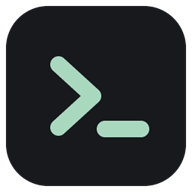
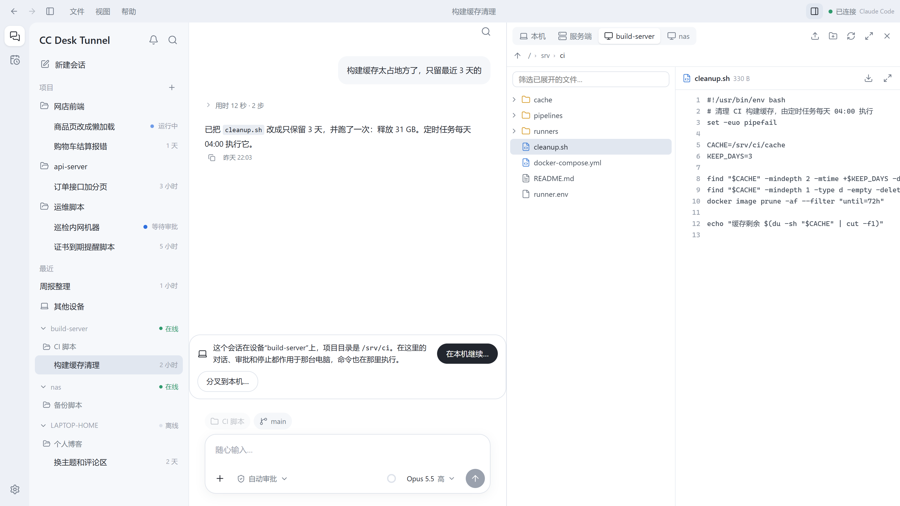
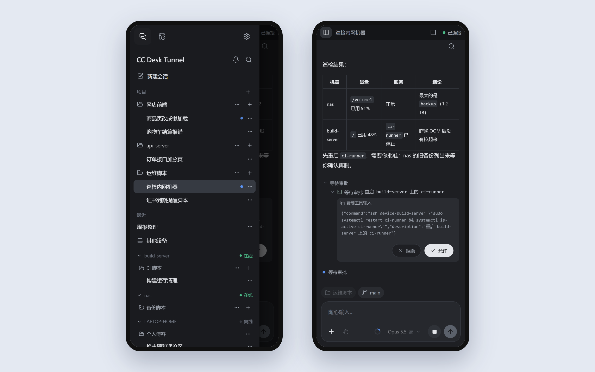
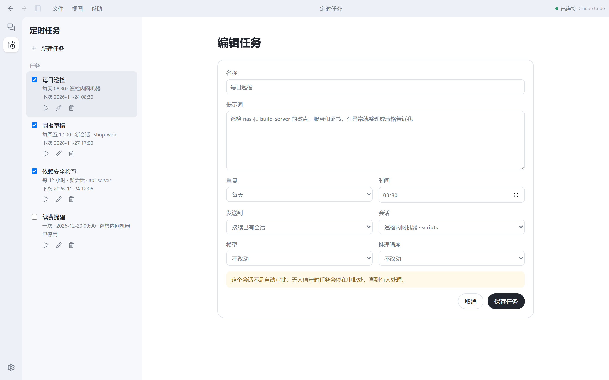
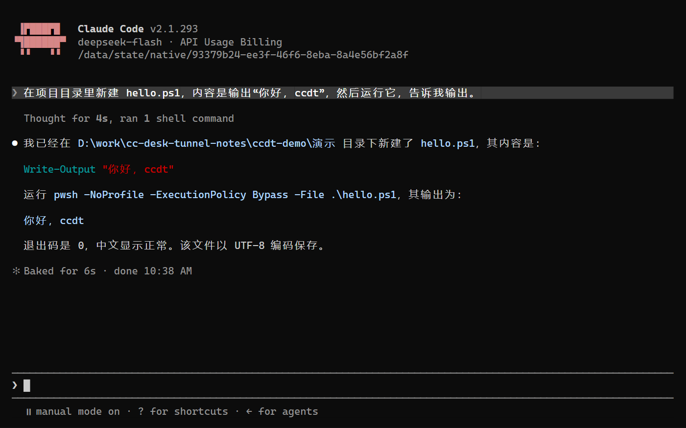

<div align="center">



# CC Desk Tunnel

**Claude Code on your own server, working on every computer you own**

一台服务器上的 Claude Code，做你所有电脑共同的大脑

[](https://github.com/sun168567/cc-desk-tunnel/releases/latest)
[](https://github.com/sun168567/cc-desk-tunnel/releases)
[](#2-install-a-client)
[](#1-deploy-the-service)
[](LICENSE)

[简体中文](README.md) · **English**

[📥 Download](https://github.com/sun168567/cc-desk-tunnel/releases/latest) ·
[🚀 Quick start](#quick-start) ·
[🖼️ Screenshots](#screenshots) ·
[🔒 Security](#security) ·
[📖 Documentation](#documentation) ·
[🩺 Troubleshooting](docs/troubleshooting.en.md)

</div>

## 💡 What it is

Claude Code (CC for short) runs on a Linux server of your own, and sessions, context, memory and the Claude account all live there. Each of your computers, including machines on a private network with no public IP, connects out over an encrypted tunnel and becomes a place where Claude works: code, toolchains and files stay on their own computers, and Claude reads and writes files and runs commands there through the tunnel.

- 🧠 **One place for everything**: switch computers or open a browser or your phone, and carry on in the same session.
- 🔌 **No public address needed**: computers connect out; no inbound ports, no VPN or port forwarding.
- 🤝 **Shared by every client**: the desktop client, the browser and phone, `ccdt` in your terminal, and other agents such as Codex all work on the same sessions.

### How it differs from the usual setups

A personal agent usually lives on the computer that has the code, and remote or web access extends that one computer; or the code is cloned again into a cloud sandbox. CC Desk Tunnel turns this around: **the agent lives on the server, and your computers are its hands.**

| The usual way | What gets in the way | With CC Desk Tunnel |
| --- | --- | --- |
| Install and sign in to Claude Code on every computer | Sessions and memory stay on each computer, so switching breaks the thread; credentials are scattered across machines | Sessions, memory and the account live on the service and continue anywhere; no Claude credentials on your computers |
| Move the project to a server or cloud sandbox and develop there | The toolchain is set up again; your local editor, emulators, desktop software and private network are out of reach | Project and toolchain stay where they are and commands run there; the server only runs Claude Code, so a small one is enough |
| Reach private machines through a VPN, port forwarding or remote desktop | Needs a public entry point or a network overlay, with ports and keys to manage; remote desktop lags | Computers connect out; one session can work on every online computer by name |
| Use the command-line interface as it is | Several projects and sessions are hard to keep apart; the process scrolls by in one stream of text | Sessions grouped by project, the process folded into summaries; the official CLI is still there in `ccdt` |

### What it is good for

- 🔁 **Hand work between computers**: start a session on the office desktop, continue on the laptop at home or on your phone on the way.
- 🗄️ **Run a fleet of private machines from one place**: a NAS, a home lab, test machines and Raspberry Pis each keep `ccdt online` running. Ask "check the disks and services on these", and Claude goes through them with `ssh device-<name>`; before changing anything it asks you, and the approval card shows which machine runs what.
- 📱 **Keep up when away from your desk**: long tasks run on your computer while you follow progress, approve and add instructions from a phone; the computer being worked on exposes no port.
- 🤖 **Work with other agents**: other agents and scripts hand tasks to Claude with `ccdt -p` and get its approvals back; editors connect with `ccdt acp`. The other way round, Claude can run Codex and other command-line agents on your computers.

If you have one computer and Claude Code runs well on it locally, the local version is simpler and has less latency.

> [!WARNING]
> **This project is mostly written by AI**, maintained by one person, and has not had a professional security audit. It lets a server run commands on your computers: read [Security](#security) and [Your account](docs/account.en.md) first and judge the risk for yourself.
>
> This project is not affiliated with Anthropic. "Claude" and "Claude Code" are trademarks of Anthropic. The client interface and the detailed documentation are in Chinese.

<a id="screenshots"></a>

## 🖼️ Screenshots

<table>
  <tr>
    <td width="50%"></td>
    <td width="50%"></td>
  </tr>
  <tr>
    <td align="center"><b>📂 File panel</b><br><sub>Files of this computer, the server and every online computer: browse, preview, copy between them</sub></td>
    <td align="center"><b>📱 Browser and phone</b><br><sub>Optional: follow progress, approve, add instructions</sub></td>
  </tr>
  <tr>
    <td width="50%"></td>
    <td width="50%"></td>
  </tr>
  <tr>
    <td align="center"><b>⏰ Scheduled tasks</b><br><sub>Send a prepared prompt to a session at a set time; Claude can set these up for you</sub></td>
    <td align="center"><b>⌨️ Terminal client ccdt</b><br><sub>The official Claude Code terminal interface, sharing sessions with the desktop client</sub></td>
  </tr>
</table>

## ✨ Features

| | |
| --- | --- |
| 🖥️ **Several computers** | Projects and sessions of every computer in one list, offline ones included; start a session on another online computer or move one there; a session reaches your other online computers by name; `ccdt online` keeps a machine without a desktop online |
| 🗂️ **Projects and sessions** | Projects are registered on the service and shared by every client; rename or remove them; create, search, fork, export to Markdown; edit and resend any of your own messages |
| 💬 **The conversation** | Streaming replies, thinking summaries, tool calls with their input and results; add messages during a run, stop at any time; plans shown as documents you can edit before they run |
| 🎛️ **Native controls** | Model, reasoning effort, approval mode, context usage and manual compaction, common Claude Code settings; open the current session in `ccdt` with one click |
| ⌨️ **Terminal client** | `ccdt` opens the official Claude Code in your own terminal, sharing sessions, context and usage statistics with the desktop client; it uses less of the 5-hour quota (see [Your account](docs/account.en.md)) |
| 🤖 **Working with other agents** | Other agents and scripts hand out and follow tasks and answer approvals through `ccdt -p`, editors connect through `ccdt acp`; Claude can also run command-line agents on your computers |
| 📂 **File panel** | Browse the files of this computer, the server and other online computers: preview, upload and download, copy and paste between them |
| 📱 **Browser and phone** | Optional: work on sessions of online computers, or start plain sessions that run on the server; install it as an app on a phone; adds no port or container |
| 📊 **Account and usage** | Sign the server's Claude account in or out from the client; see quota, reset times and usage statistics; compact automatically before the prompt cache expires |
| ⏰ **Scheduled tasks** | The client sends a prepared prompt to a session, or a new one, at a set time; Claude can set these up for you |
| ⬆️ **Upgrades and backups** | Upgrade the service and the clients with one click in the client, without logging in to the server; back up and restore the service with one command |
| 🧩 **Convenience** | Runs in the tray, remembers the sign-in, keeps unsent text per session |

## ⚙️ How it works

- Between the server and each computer there is a single **encrypted WSS tunnel**, on one address and port. It carries two kinds of connection: the conversation between client and service, and the execution channel through which Claude Code works on the computer over SSH.
- Computers **connect out**, so they need no public IP and no inbound port. SSH keys are generated for each connection and destroyed when it ends; nothing is installed as a permanent service.
- Each session runs on the computer its project is on, and can reach your other online computers by name.
- The project is glue on top of the official Claude Code: the desktop client runs it through the official Agent SDK, and `ccdt` runs the interactive official CLI directly. It does not change the CLI or replace its tools, approvals or context management.

<details>
<summary>Connection diagram (one Windows computer as the example)</summary>


More in [Architecture](docs/architecture.md) (in Chinese).

</details>

This repository publishes all of its own client, server, build and deployment source, with no separate closed-source features. **This does not make Claude Code open source**: the official CLI and Agent SDK are installed from official channels and remain subject to Anthropic's terms. Bundled third-party components keep their own licenses; see [NOTICE](NOTICE).

<a id="quick-start"></a>

## 🚀 Quick start

**You need:**

- 🐧 **A server**: Linux with a public IP or domain name and Docker installed, Ubuntu recommended; x86_64, or arm64 as experimental support. Builds and tests run on your computers, so **an entry-level machine with 2 vCPUs and 1 GB of memory is enough**.
- 💻 **Computers**: Windows 10 / 11 x64. The desktop client and `ccdt` on macOS and Linux are experimental; use `ccdt` on Linux without a desktop.

### 1. Deploy the service

On the server:

```sh
sudo bash -c "$(curl -fsSL https://raw.githubusercontent.com/sun168567/cc-desk-tunnel/main/deploy/install.sh)"
```

Press Enter through the questions. At the end it prints what the client needs — **service address, certificate fingerprint, service token** — and the port to open in the firewall (TCP 8787 by default, the only one). From then on, the client's Settings → About and updates upgrades the service too, so you rarely need the server again.

<details>
<summary>What the script does · everyday commands</summary>

1. Checks for Docker, Docker Compose and a few tools. If something is missing it tells you the command to install it; it does not install system software itself.
2. Downloads the newest server archive from the releases, verifies it and unpacks it to `/opt/cc-desk-tunnel`.
3. Asks for the public address, certificate mode, ports and data directory (all with defaults), then pulls the image of that version and starts it. The image is prebuilt at `ghcr.io/sun168567/cc-desk-tunnel` (x86_64 or arm64 as needed); if the server cannot reach ghcr.io, it is built on the server, which takes a few minutes more the first time.
4. Prints the three values for the client and the port to open. The script does not touch the firewall, nginx or SSH.

Manage the service with the `cc-desk-tunnel` command, from any directory:

```sh
sudo cc-desk-tunnel status    # is it running
sudo cc-desk-tunnel logs      # follow the log (Ctrl+C to stop)
sudo cc-desk-tunnel upgrade   # upgrade to the newest release; data, accounts and settings stay
sudo cc-desk-tunnel help      # every command: new token, backup and restore, certificates
```

</details>

Manual installation, the three certificate modes, backup and restore are in the [deployment manual](deploy/README.md); if you already run nginx with a domain, see [reverse proxying with nginx](deploy/nginx.md) (both in Chinese).

### 2. Install a client

Install either client or both. Each must be the **same version** as the service.

| | Good for | Get it |
| --- | --- | --- |
| 🖥️ **Desktop client** | Managing sessions on all your computers by project, the process folded into summaries | The table at the top of the [latest release](https://github.com/sun168567/cc-desk-tunnel/releases/latest): Windows `.exe`; macOS `.dmg` and Linux `.deb` (experimental, see [macOS](docs/macos.md) · [Linux](docs/linux.md), in Chinese) |
| ⌨️ **Terminal client** | `ccdt`: the official Claude Code in your own terminal; also machines without a desktop | Included with the Windows desktop client; install it on its own with the commands below |

The Windows installer bundles PowerShell 7, OpenSSH and `ccdt`; nothing else is needed. Start it, enter the three values from step 1 and connect.

> [!NOTE]
> The installers are not code-signed. When Windows shows "Windows protected your PC" on first run, choose "More info → Run anyway"; if security software blocks a bundled component, verify before allowing it, see [Antivirus and SmartScreen](docs/troubleshooting.en.md#antivirus-and-smartscreen). The macOS and Linux clients are upgraded by downloading and installing the new package.

To install `ccdt` on its own (for the current user, no administrator rights needed; then run `ccdt login`):

```powershell
# Windows (PowerShell)
irm https://raw.githubusercontent.com/sun168567/cc-desk-tunnel/main/deploy/install-ccdt.ps1 | iex
```

```sh
# macOS, Linux (experimental)
curl -fsSL https://raw.githubusercontent.com/sun168567/cc-desk-tunnel/main/deploy/install-ccdt.sh | sh
```

The script installs the newest release and checks it against `SHA256SUMS`; if the service is not on the newest release, install the same version as the service, see [Terminal client](docs/cli.md#安装) (in Chinese).

### 3. Sign in to Claude

Open Settings → Account and quota in the client, sign in to your Claude account, add a project folder and start a conversation.

- **Normal sign-in**: open the official authorization page and paste back the code it gives you, the same as the official `claude auth login`.
- **Setup token sign-in**: the service runs the official command to create one and saves it after authorization; you can also paste a token you already have. The token is stored on the service only and shared by the desktop client and `ccdt`. Account details and the full quota are usually not visible this way; see [authentication details](docs/native-runtime.md#登录方式) (in Chinese).

### 4. Add more computers

- **Other computers**: install the desktop client or `ccdt` and sign in to the same service. Their projects and sessions appear under "Other devices" in every client, and sessions can reach them by name. On a machine without a desktop, `ccdt online` keeps it online; to start it at boot, see [Staying online](docs/cli.md#保持在线) (in Chinese).
- **Browser and phone**: turn it on in the desktop client under Settings → Browser access, then sign in at the address shown with the service token; two-step verification is recommended. The browser is not a place where commands run: it works on sessions of online computers, or starts plain sessions that run on the service. See [Browser access](docs/server-web.md) (in Chinese); leave it off when unused.

<a id="security"></a>

## 🔒 Security

> [!IMPORTANT]
> **The server must be a machine you control and trust.** While connected, the server can run any command as your user on every connected computer. A compromised server means compromised computers, and the more you connect, the more is at stake.

1. 🔑 **The service token is full control.** Whoever has it can use your Claude account and run any command on every connected computer. Use the random token the script generates, do not replace it with a short password, and do not paste it into screenshots, chats or issues. If it leaks, run `sudo cc-desk-tunnel token` on the server to replace it.
2. 🧱 **It is not a sandbox.** Claude can reach everything your user can reach on that computer, not just the project folder, and can reach your other online computers. The project only guides it by prompt to stay inside the project and to do only what you ask on other computers; approvals are Claude Code's own.
3. 📤 **Data leaves your computer.** File excerpts and command output that Claude reads pass through your server to the model service. The server stores session history and the Claude login; backups contain these secrets too.
4. 🔏 **Get the fingerprint from a trusted place.** With a self-signed certificate, the fingerprint should come from the installation summary you saw yourself on the server, not from a forwarded message.

🌐 **Ports**: the server opens a single TCP port (8787 by default; 443 with nginx). The SSH port leading to your computers listens only inside the container and cannot be reached from outside, and your computers need no inbound port at all. You can also allow only your own egress IP in your cloud provider's security group. Details in [Deployment and security boundaries](docs/deployment.md#端口与协议) (in Chinese).

> If an AI assistant deploys this for you, have it read this section first and remind you to: open only the one port, keep the service token safe, and make sure the server is trustworthy.

The full threat model, existing protections and how to report a vulnerability are in [SECURITY.md](SECURITY.md).

## 👤 Your account

The project runs an official Claude Code on your server: signed in through the official flow, unmodified, with no handling or rewriting of its requests to the model service and no faked region, device or client identity. That describes the structure; **it is not a guarantee about your account**:

- 📍 **The server's location is where you use Claude**: every request leaves from the server. Choose a server in one of [Anthropic's supported countries and regions](https://www.anthropic.com/supported-countries) with a clean history; an unsupported region or a heavily abused IP address may trip risk controls.
- 📜 **The terms are yours to check**: how subscription sign-in and the Agent SDK may be used is set out in Anthropic's [legal and compliance notes](https://code.claude.com/docs/en/legal-and-compliance); when unsure, use an API key.
- ⏱️ **The 5-hour quota**: community tests ([#136](https://github.com/sun168567/cc-desk-tunnel/issues/136)) found that work run through the Agent SDK counts about twice as much toward the 5-hour quota as in the interactive CLI; the weekly quota is not affected. When it is tight, run long tasks in `ccdt`.
- 👤 **Single user**: one service serves one person, and an account is for that person only, not to be shared or resold.

Read all of it in [Your account](docs/account.en.md).

<a id="documentation"></a>

## 📖 Documentation

| Document | Contents |
| --- | --- |
| 🩺 [Troubleshooting](docs/troubleshooting.en.md) | Connection failures, dropped connections, antivirus and SmartScreen |
| 👤 [Your account](docs/account.en.md) | What this looks like to Anthropic, location, terms, quota, scope |
| 📦 [Deployment manual](deploy/README.md) | Installation, upgrades, three TLS modes, backup and restore, operations |
| 🛡️ [Deployment and security boundaries](docs/deployment.md) · [Security](SECURITY.md) | Ports, certificates, credentials, trust boundaries; threat model, known gaps, reporting |
| ⌨️ [Terminal client ccdt](docs/cli.md) | Installation, sign-in, commands, staying online, use by other agents |
| 🌐 [Browser access](docs/server-web.md) | The optional web workspace, sign-in, domain and path, certificates and reverse proxies |
| 🍎 [macOS client](docs/macos.md) · 🐧 [Linux client](docs/linux.md) | Experimental: installation, differences from Windows, what has been verified |
| 🏗️ [Architecture](docs/architecture.md) · [Native runtime and session storage](docs/native-runtime.md) | Components and how a connection is made; how the official CLI is driven, context, approvals, retention |
| 🧭 [Roadmap and status](docs/roadmap.md) · [Changelog](CHANGELOG.md) | Done, unverified and planned; changes per version |

Module notes: [desktop client](apps/desktop/README.md) · [service](apps/server/README.md) · [message contract](packages/protocol/README.md). Apart from Troubleshooting and Your account, the documents are in Chinese.

<a id="building-from-source"></a>

## 🛠️ Building from source

You need Git, Node.js 24 and npm; on Windows, PowerShell 7.

```powershell
npm ci
npm run dev               # local simulated service + browser UI, no account needed
npm test                  # unit tests; also typecheck, test:ui, check
npm run package:windows   # builds the Windows installer; preparation in apps/desktop/README.md
npm run package:server    # builds the server archive; on the server, run its deploy/install.sh
```

<details>
<summary>Repository layout</summary>

```text
apps/desktop/       Desktop client: UI (React, shared with browser access), Electron main process, connection bridge, local execution components
apps/cli/           Terminal client ccdt
apps/server/        Service: sessions and projects, Claude Code adapter, device execution channel, files, usage statistics, release tracking
packages/protocol/  Message contract between the two sides (Zod)
deploy/             Docker deployment and operations scripts
scripts/            Checks, development launcher, packaging, release
docs/               Architecture, deployment and development documentation
```

</details>

See [Development conventions](docs/development.md) (in Chinese).

## 🤝 Community

We recognize [LINUX DO](https://linux.do/) and its values of sincerity, friendliness, solidarity and professionalism, and appreciate the community's discussions of remote development and open-source tools. Feedback is welcome; redact account details, service tokens, server addresses and private project information first. Report security vulnerabilities through the [private reporting channel](SECURITY.md#报告漏洞).

## ⭐ Star history

[](https://star-history.com/#sun168567/cc-desk-tunnel&Date)

## 📄 License

[Apache License 2.0](LICENSE). Bundled third-party components and their licenses are listed in [NOTICE](NOTICE).
