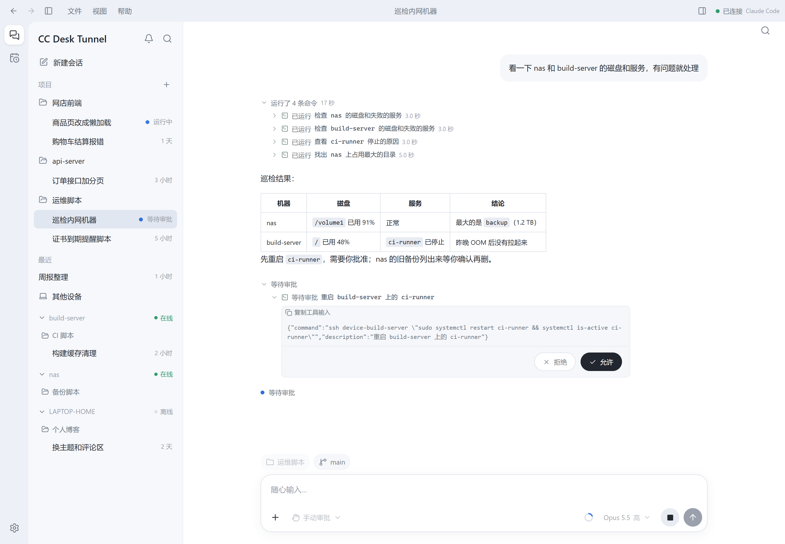
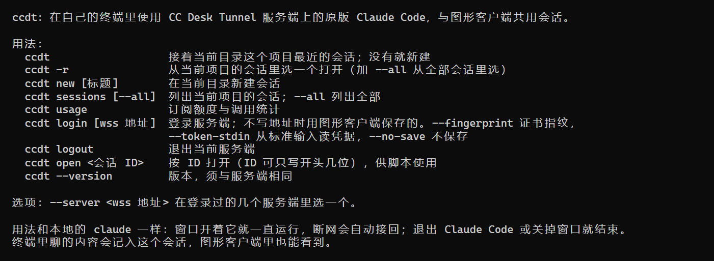
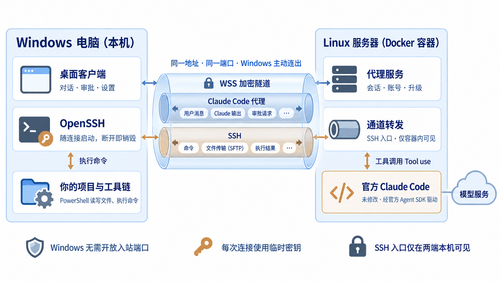

# CC Desk Tunnel（CC 桌面隧道）

**简体中文** | [English](README.en.md)

一台服务器上的 Claude Code，做你所有电脑共同的大脑。

Claude Code（简称 CC）运行在你自己的一台 Linux 服务器上，会话、上下文、记忆和 Claude 账号都集中在那里。你的每台电脑，包括没有公网 IP 的内网机器，主动连出一条加密通道，就成为 Claude 可以操作的执行端：项目代码、工具链和文件留在各自的电脑上，Claude 经通道在那里读写文件、运行命令。

图形客户端、浏览器和手机、终端里的 `ccdt`，以及 Codex 等其他 agent，用的都是同一批会话：在哪一端开始，就能在哪一端接着做。

**下载**：[图形客户端](#图形客户端) · [终端客户端 ccdt](#终端客户端-ccdt) · [服务端](#1-部署服务端) · [全部版本](https://github.com/sun168567/cc-desk-tunnel/releases) | [快速开始](#快速开始) · [安全须知](#安全须知) · [文档](#文档) · 许可：[Apache-2.0](LICENSE)

> [!WARNING]
> **本项目主要由 AI 编写**，由个人维护，没有经过专业的安全审计，可能存在尚未发现的缺陷。它会让一台服务器获得在你电脑上执行命令的能力，使用前请读完[安全须知](#安全须知)和[账号须知](#账号须知)，并自行评估风险。
>
> 本项目与 Anthropic 没有隶属或合作关系。“Claude”“Claude Code”是 Anthropic 的商标。

## 和常见做法有什么不同

个人用的 agent 通常装在代码所在的那台电脑上，远程、网页端是这台电脑的延伸；要么就在云端沙箱里另外克隆一份代码来跑。CC Desk Tunnel 反过来：agent 常驻在服务器上，你的电脑是它的手。

| 常见做法 | 麻烦在哪 | 用 CC Desk Tunnel |
| --- | --- | --- |
| 每台电脑各装一份 Claude Code，各登录一次 | 会话和记忆留在各自的电脑上，换一台就接不上；Claude 的登录凭据散在每台电脑上 | 会话、记忆和账号都在服务端，换哪台电脑、在浏览器或手机上都能接着做；电脑上不存 Claude 的凭据 |
| 把项目搬到服务器或云端沙箱，让 agent 在那里开发 | 工具链要重装一遍，编译、测试吃配置；用不到本机的编辑器、模拟器、桌面软件和内网资源 | 项目和工具链留在原地，命令也在原地执行；服务器只跑 Claude Code，低配即可 |
| 经 VPN、内网穿透或远程桌面去操作内网里的机器 | 要有公网入口或先组网，端口和密钥都要管；远程桌面延迟高，输入和复制别扭 | 电脑主动连出，不需要公网 IP、入站端口或 VPN；一个会话就能按名字操作你所有在线的电脑 |
| 直接用命令行界面 | 多个项目和会话不好管理，工具调用和思考过程挤在一屏滚动的文字里 | 按项目分组的会话列表，过程折叠成摘要、可逐级展开；想用原版 CLI 时在 `ccdt` 里照常用 |

## 适合怎么用

- **在几台电脑之间接力。** 公司台式机上开的会话，回家在笔记本上、路上在手机上接着做；项目和 Claude 的项目记忆都在服务端，跟着你走。
- **一站式管理一批内网设备。** NAS、家庭实验室、内网服务器、测试机、树莓派，各自运行 `ccdt online` 保持在线（可以用 systemd 开机常驻）。在一个会话里说“看看这几台的磁盘和服务状态”，Claude 用 `devices` 找到它们，逐台 `ssh device-<名字>` 去查；要改动时先问你，审批卡片上写着要在哪台机器上执行什么。文件面板也能直接浏览这些机器。
- **离开电脑也能跟进。** 长任务在电脑上跑，人在外面用手机浏览器看进度、批准、追加指示；被操作的电脑不暴露任何端口。
- **和其他 agent 协作。** 其他 agent 或脚本用 `ccdt -p` 把任务交给 Claude，审批交回给调用方；会说 ACP 的编辑器用 `ccdt acp` 接入。反过来，Claude 也能调用你电脑上的 Codex 等命令行 agent。派出的任务都是普通会话，在一个地方看得到、管得了。

只有一台电脑、在本机跑 Claude Code 已经很顺手时，直接用本地版更简单，延迟也更低。

## 效果示例

图形客户端：按项目分组的会话列表，下方是其他电脑上的项目和会话，在线的可以直接在这里操作。



终端客户端 `ccdt`：在自己的终端里打开原版 Claude Code，与图形客户端共用会话。




## 工作方式

以一台 Windows 电脑为例：



- 服务器和每台电脑之间只有一条 WSS 加密隧道，用同一个地址和端口。里面有两类连接：客户端与服务端之间的对话（文档里叫控制连接），和 Claude Code 经 SSH 操作这台电脑的执行通道。
- 电脑主动连出，不需要公网 IP，也不需要开放任何入站端口。每次连接临时生成 SSH 密钥，断开即销毁，电脑上不安装常驻服务。
- 每个会话在它的项目所在的那台电脑上执行，同时能按名字连到你其他在线的电脑。
- 项目只是官方 Claude Code 之上的一层胶水：图形客户端经官方 Agent SDK 运行它，`ccdt` 在终端里直接运行交互式的原版 CLI。不改 CLI 本体，不替换它的工具、审批和上下文管理；会话与长期记忆由服务端的 Claude Code 自己保存。

本仓库公开客户端、服务端以及构建、部署脚本的全部自有源码，不另设闭源功能。**这不意味着 Claude Code 也被本项目开源**：官方 CLI 与 Agent SDK 由官方渠道安装，仍按 Anthropic 的条款使用；随包的第三方组件各自遵循其许可，详见 [NOTICE](NOTICE)。

## 功能

| | |
| --- | --- |
| **多台电脑** | 每台电脑的项目和会话集中列出，离线的也在；在另一台在线电脑上新建会话、把会话移过去；一个会话按名字连到你其他在线的电脑；`ccdt online` 让没有图形界面的机器保持在线 |
| **项目与会话** | 项目由服务端登记，各端共用，可改名、移除；新建、搜索、分叉、导出 Markdown；从任意一条自己的消息“编辑重发” |
| **对话过程** | 流式回复、思考摘要、工具调用的入参与结果；运行中追加消息、随时停止；计划显示为文档，可修改后再执行 |
| **原生控制** | 模型、推理强度、审批模式、上下文占用与主动压缩、Claude Code 常用设置；需要时一键在终端客户端 `ccdt` 里打开会话 |
| **终端客户端** | `ccdt` 在自己的终端里打开原版 Claude Code，与图形客户端共用会话、上下文和调用统计；更省 5 小时额度（见[账号须知](#账号须知)） |
| **与其他 agent 协作** | 其他 agent 和脚本经 `ccdt -p` 派发、跟进任务并处理审批，编辑器经 `ccdt acp` 接入；Claude 也能调用电脑上的命令行 agent |
| **文件面板** | 浏览本机、服务端和其他在线电脑的文件：预览、上传下载、在不同位置之间复制粘贴 |
| **浏览器与手机（可选）** | 操作在线电脑上的会话，或新建在服务端执行的普通会话；手机上可以安装为应用；默认关闭，不增加端口或容器 |
| **账号与用量** | 在客户端里登录 / 退出服务端的 Claude 账号，查看额度、重置时间和调用统计；提示缓存过期前可自动压缩 |
| **定时任务** | 到点由客户端向指定会话或新会话发送预设提示词，也可以直接让 Claude 帮你设置 |
| **省心** | 托盘后台、记住凭据与自动登录、未发送内容按会话保存 |
| **升级与备份** | 服务端跟踪发布页，在客户端里点一下即可升级服务端和客户端，不必登录服务器；服务端一条命令备份与还原 |

## 快速开始

需要：一台有公网 IP 或域名的 Linux 服务器（x86_64；arm64 为实验性支持。推荐 Ubuntu，已安装 Docker），以及要让 Claude 操作的电脑：Windows 10 / 11 x64；macOS、Linux 上的图形客户端和 `ccdt` 为实验性支持，没有图形界面的 Linux 用 `ccdt`。

**服务器不需要高配。** 编译、测试和各种开发工具都在你的电脑上运行，服务器上只有 Claude Code 和一个轻量的代理服务，2 核 1 GB 内存的入门机型就能运行。只有打算让 Claude 直接在服务器上编译或跑重负载时，才需要按那些任务选配置。

### 1. 部署服务端

在服务器上执行：

```sh
sudo bash -c "$(curl -fsSL https://raw.githubusercontent.com/sun168567/cc-desk-tunnel/main/deploy/install.sh)"
```

脚本会：

1. 检查 Docker、Docker Compose 等依赖。缺少时只告诉你安装命令，不会替你安装系统软件。
2. 从本仓库的发布页下载最新的服务端程序包并校验，解压到 `/opt/cc-desk-tunnel`。
3. 询问公网地址、证书方式、端口和数据目录（都有默认值，一路回车即可），然后拉取这个版本的镜像并启动。
4. 打印客户端要填的**服务地址、证书指纹、服务凭据**，以及需要在防火墙放行的 TCP 端口（默认 8787，只有这一个）。

镜像是 GitHub 上预先构建好的（`ghcr.io/sun168567/cc-desk-tunnel`，x86_64 和 arm64 自动选择），几分钟内就能装好。服务器连不上 ghcr.io 时，脚本会改为在服务器上构建，首次需要多等几分钟。脚本不会修改防火墙、nginx 或 SSH 配置。

装好后，日常管理用 `cc-desk-tunnel` 命令，在任何目录下都能运行：

```sh
sudo cc-desk-tunnel status    # 运行状态
sudo cc-desk-tunnel logs      # 查看日志（Ctrl+C 退出）
sudo cc-desk-tunnel upgrade   # 升级到最新版本；数据、账号和配置保留
sudo cc-desk-tunnel help      # 全部命令：更换凭据、备份恢复、证书等
```

一般不需要上服务器升级：客户端的“设置 → 关于与更新”里可以直接升级服务端。手动安装、三种证书方式、备份恢复等见[部署操作手册](deploy/README.md)；已有 nginx 和域名时见[用 nginx 反代](deploy/nginx.md)。

### 2. 安装客户端

客户端有两种，可以只装一种，也可以都装；都要与服务端同一版本。

- **图形客户端**：桌面应用，按项目管理各台电脑上的会话，对话过程折叠成摘要、可逐级展开。
- **终端客户端 `ccdt`**：在自己的终端里使用原版 Claude Code，与图形客户端共用会话。

#### 图形客户端

从[最新发布页](https://github.com/sun168567/cc-desk-tunnel/releases/latest)下载，页面开头的表格按系统列出了安装包，点击即下载：

- Windows 10 / 11 x64：`.exe` 安装包。
- macOS（实验性）：Apple 芯片或 Intel 的 `.dmg`，见 [macOS 客户端](docs/macos.md)。
- Linux x64（实验性）：`.deb`，见 [Linux 客户端](docs/linux.md)。

Windows 安装包自带 PowerShell 7、OpenSSH 和终端客户端 `ccdt`，不需要另装任何东西。启动后填入上一步的三项信息并连接。首次运行会遇到 SmartScreen 提示，处理方法见[杀毒软件与 SmartScreen](#杀毒软件与-smartscreen)。macOS 与 Linux 的客户端没有签名，升级时需要重新下载安装。

#### 终端客户端 ccdt

装了 Windows 图形客户端就已经有 `ccdt`，新开的终端窗口里直接用。只用终端时单独安装，Windows 在 PowerShell 里运行：

```powershell
irm https://raw.githubusercontent.com/sun168567/cc-desk-tunnel/main/deploy/install-ccdt.ps1 | iex
```

macOS、Linux（实验性）：

```sh
curl -fsSL https://raw.githubusercontent.com/sun168567/cc-desk-tunnel/main/deploy/install-ccdt.sh | sh
```

脚本从发布页下载最新的正式版，按 `SHA256SUMS` 校验后只为当前用户安装，并把 `ccdt` 加入 PATH，不需要管理员权限。装好后运行 `ccdt login` 登录服务端。服务端不是最新版时，先指定与它相同的版本，见[终端客户端](docs/cli.md#安装)。

### 3. 登录 Claude

在客户端“设置 → 账号与额度”登录你的 Claude 账号，添加一个项目文件夹，开始对话。可以选择：

- **普通登录**：打开官方授权页，完成后把页面给出的代码粘贴回来，沿用官方 `claude auth login` 流程。
- **Setup token 登录**：由服务端运行官方命令生成，完成浏览器授权后自动保存，并显示一次供你复制；已有令牌也可以直接粘贴。令牌只保存在服务端，图形客户端与 `ccdt` 共用。这种方式通常看不到账号资料、完整订阅额度和到期时间，以实际请求为准，见[登录方式差异](docs/native-runtime.md#登录方式)。

### 4. 接入更多电脑

在其他电脑上装图形客户端或 `ccdt`，登录同一个服务端即可：它们的项目和会话随即出现在每一端的“其他设备”下，会话也能按名字连到它们。没有图形界面的机器运行 `ccdt online` 保持在线，开机常驻的写法见[保持在线](docs/cli.md#保持在线)。

要在浏览器或手机上使用时，在桌面客户端“设置 → 浏览器访问”中开启，再用服务凭据登录显示的地址，建议开启验证器两步验证。浏览器本身不是执行端：它操作在线电脑上的会话，或新建在服务端执行的普通会话。使用范围、证书和登录设置见[浏览器访问](docs/server-web.md)；不使用时保持默认关闭。

## 安全须知

**一个前提：服务器必须是你自己控制、可信的机器。** 连接期间，服务器能以你的用户身份在每台已连接的电脑上执行任意命令。服务器被攻陷，等于这些电脑都被攻陷；接入的电脑越多，影响面越大。不要把它部署在与他人共用或来路不明的机器上。

### 端口

| 端口 | 用途 | 是否需要放行 | 靠什么保护 |
| --- | --- | --- | --- |
| 服务端口（默认 8787/TCP） | 客户端登录与对话；Claude 到你电脑的执行通道也由客户端经它建立 | 需要。nginx 模式下改为放行 nginx 的 443，8787 只监听本机 | TLS + 服务凭据 + 登录限速；执行通道另有每次连接随机生成的密钥 |
| 通往你电脑的 SSH 端口（随机） | Claude 在你的电脑上执行命令 | **不需要，也无法放行** | 只监听容器内部的回环地址，没有发布到服务器，更不会出现在公网；只接受本次连接的临时公钥 |

- **电脑一侧**不需要放行任何入站端口；本机的 SSH 服务只监听回环地址，随连接启停。
- **如果服务器的防火墙放行了全部端口**：SSH 端口依然无法从外部访问，本项目暴露的仍然只有上面这一个端口，安全性取决于服务凭据。但全部放行会把服务器上的其他服务（例如它自己的 SSH）暴露出去，建议只放行需要的端口。
- 想进一步收紧，可以在云厂商的安全组里只允许你自己的出口 IP 访问这个端口。注意 Docker 发布的端口通常不受 `ufw` 规则限制，来源限制请在云厂商的安全组里做。

### 必须知道的四件事

1. **服务凭据等同于完全控制权。** 拿到它的人可以使用你的 Claude 账号，并在你每台已连接的电脑上执行任意命令。使用脚本自动生成的随机凭据，不要改成短口令，不要截图或贴到聊天、issue 里；泄漏后在服务器上执行 `manage.sh token` 更换。
2. **不是沙箱。** Claude 能访问你的用户在那台电脑上能访问的一切，而不只是项目目录，也能连到你其他在线的电脑。项目只靠提示词引导它在项目内工作、到其他电脑上只做你要求的事，审批沿用 Claude Code 自己的机制。
3. **数据会离开本机。** Claude 读取的文件片段和命令输出会经过你的服务器发往模型服务；服务器上保存着会话记录和 Claude 登录凭据，备份文件同样包含这些秘密。
4. **指纹要从可信渠道取得。** 使用自签证书时，证书指纹应当来自你自己登录服务器看到的安装汇总，而不是别人转发的消息。

> 请 AI 助手帮你部署时，也请让它先读这一节，并提醒你完成：只放行一个端口、妥善保存服务凭据、确认服务器可信。

完整的威胁模型、已有的防护和漏洞报告方式见 [SECURITY.md](SECURITY.md)；端口、证书与信任边界的细节见[部署与安全边界](docs/deployment.md)。

## 账号须知

**在 Anthropic 看来，这是什么？** 是一份运行在你服务器上的官方 Claude Code：通过官方流程登录，图形客户端经官方 Agent SDK 运行它，`ccdt` 运行交互式的原版 CLI，都直接从服务器连接模型服务。本项目不修改 Claude Code，不经手也不改写它与模型服务之间的请求，不伪造地区、设备或客户端身份。Claude 在你电脑上执行命令的方式，与你在服务器上用 Claude Code 通过 SSH 操作另一台机器没有区别。

这只是对结构的说明，**不是对账号安全的保证**。请留意：

- **服务器所在地就是你的使用地点。** Claude Code 的全部请求都从服务器发出。请选择位于 [Anthropic 支持的国家和地区](https://www.anthropic.com/supported-countries)、来源正常的服务器。即使你本人身处支持的地区，把服务端放在不支持的地区，或放在被大量滥用过的 IP 上，也可能触发风控而被误判。本项目不会、也不能改变或掩饰这一点。
- **条款由你自己确认。** Anthropic 对订阅登录和 Agent SDK 的使用范围有明确规定（见其[法律与合规说明](https://code.claude.com/docs/en/legal-and-compliance)），其中限制第三方产品提供 Claude.ai 登录或代为使用订阅额度。技术上能用不代表你的用法获得了许可；拿不准时改用 API key（在数据目录的 `config/provider.json` 中配置）。
- **5 小时额度的计法可能不同。** 据社区实测（见 [#136](https://github.com/sun168567/cc-desk-tunnel/issues/136)），同样的用量，经 Agent SDK 运行时计入 5 小时额度的比例约为交互式 CLI 的两倍，每周额度不受影响。5 小时额度紧张时，在 `ccdt` 里做长任务。
- **一个账号只给自己用。** 不要用它共享或转售账号；项目不提供、也不接受这类功能。
- 项目不对账号状态、可用性或合规性作任何承诺。

## 杀毒软件与 SmartScreen

- **内置组件被拦截时，先核对再放行。** Windows 客户端带有官方发布的 OpenSSH 和 PowerShell 7，打包时校验 SHA256，只在连接期间运行，只监听本机。它们被拦截的情况少见；遇到时先确认安装包来自本仓库的[发布页](https://github.com/sun168567/cc-desk-tunnel/releases/latest)，对照 `SHA256SUMS` 校验，并查看具体被拦截的文件。确认来源后，仅对已核验的组件文件设置必要的例外，不建议关闭杀毒软件或排除整个磁盘。文件已被隔离时，可在核验后恢复或重新安装。
- **SmartScreen。** 安装包没有代码签名，首次运行会出现“Windows 已保护你的电脑”，点“更多信息 → 仍要运行”。
- 项目不会修改任何安全软件的设置。不放心可以自己从源码构建。

## 连接失败时

登录页的提示第一行是原因，后面是该检查的地方。连接分两段，可据此判断问题在哪一段：

| 提示 | 含义 | 处理 |
| --- | --- | --- |
| 无法解析域名 / 连接超时 / 拒绝了连接 | 控制连接没有到达服务端 | 核对服务地址与端口，检查服务器是否在线、控制端口是否放行 |
| 证书不受信任 / 指纹不匹配 / 证书已过期 | TLS 校验没有通过 | 自签证书填写安装时给出的 SHA256 指纹；换过证书后用新指纹；过期则在服务器上续期 |
| 服务凭据不正确 | 已连到服务端，凭据被拒绝 | 核对凭据；连续失败多次会被暂时拒绝 |
| 版本不一致 | 客户端与服务端不是同一版本 | 按登录页的提示升级 |
| SSH 服务被拦截 / 找不到 / 没能启动 | 凭据已通过，本机的 `sshd.exe` 或 PowerShell 没能运行 | 提示里带有它的输出时按输出处理；被拦截或找不到时见上一节，先看安全软件的保护记录 |
| 执行通道没有就绪 | 凭据已通过，本机 SSH 服务已启动，服务端经执行通道连不回本机 | 提示里带有具体原因时按它处理；经反向代理或系统代理连接时，确认它允许同一地址同时有多条连接 |
| 本机 SSH 服务没有执行探测命令 | 执行通道已建立，本机 SSH 服务没有执行服务端发来的探测命令 | 按“本机答复”处理，那是本机 shell 或 `ssh` 的原话 |
| 本机 OpenSSH 的默认 shell 是 … | 系统 OpenSSH 设了 `DefaultShell`（注册表 `HKLM\SOFTWARE\OpenSSH`），内置的 `sshd.exe` 也用它执行命令 | 设为 PowerShell、pwsh 或 Git Bash 时客户端自动处理，命令仍按 cmd 执行；其他 shell 需删除或改回这个值 |

### 用着用着断开时

连接断了不需要做什么：客户端留在原来的界面自己重连，一直试到连上为止，连上之后补上期间的内容。正在进行的任务在服务端继续跑；只有断开那一刻正在电脑上执行的那条命令会失败，Claude 会看到并自行处理，之后的命令等电脑连回来再执行。

电脑离线超过 5 分钟（服务端的 `PROXY_GRACE_SECONDS` 可改）任务才会停下。此时回到会话，点输入框右下角的“继续”就能接着做，不必再写一句话；手动停止的任务也一样。主动点“断开连接”或退出客户端，任务立即结束。

客户端每 15 秒确认一次服务端还在，约 45 秒没有任何回应就判定连接已断；服务端对客户端也是一样。只有服务端明确拒绝（凭据不对、版本不一致）时才会回到登录页。

要查是哪一段断的，对照两边的记录：

- **客户端**：“设置 → 关于与更新 → 打开日志文件夹”里的 `client.log`，每次连接记着何时建立、何时断开、是窗口还是服务端一侧先断开，以及原因。不含凭据、对话和命令内容。
- **服务端**：`sudo docker logs <容器名> 2>&1 | grep Connection`，每条连接记着是哪台电脑、从哪个地址来、保持了多久、怎样结束的。`no heartbeat answer for 45s` 是服务端等不到客户端的回应；`code 1006` 是对方没有打招呼就断了，多半出在途中的网络、代理或反向代理。

经代理或反向代理连接时，确认它不会掐断长时间没有多少数据的连接；nginx 的写法见[用 nginx 反代](deploy/nginx.md)。

## 使用边界

- **单用户自用。** 一个服务对应一个使用者；这个人可以同时连接自己的几台电脑，每个会话在它的项目目录所在的那台上运行。没有多用户、权限分级或租户隔离，也不打算做。
- **不改官方本体，不做对抗。** 不含任何针对风控或检测的规避设计，也不以突破服务的地区限制为目的。

## 文档

| 文档 | 内容 |
| --- | --- |
| [部署操作手册](deploy/README.md) | 安装、升级、三种 TLS 入口、备份恢复、日常运维 |
| [部署与安全边界](docs/deployment.md) | 端口、证书、凭据、数据与信任边界 |
| [浏览器访问](docs/server-web.md) | 可选 Web 工作台、登录、域名与路径、证书和反向代理 |
| [安全说明](SECURITY.md) | 威胁模型、已有防护、已知不足、漏洞报告 |
| [架构](docs/architecture.md) | 组成、连接建立过程、关键设计决定 |
| [原生运行与会话存储](docs/native-runtime.md) | 如何驱动官方 CLI、上下文归属、审批、保留期 |
| [图形客户端](apps/desktop/README.md) · [服务端](apps/server/README.md) · [消息契约](packages/protocol/README.md) | 各模块的实现说明 |
| [macOS 客户端（实验性）](docs/macos.md) · [Linux 客户端（实验性）](docs/linux.md) | 安装、与 Windows 的不同、已验证与未验证 |
| [终端客户端 `ccdt`](docs/cli.md) | 安装、登录、命令、保持在线、供其他 agent 使用、与图形客户端共用会话 |
| [路线与现状](docs/roadmap.md) · [变更记录](CHANGELOG.md) | 已完成、待验证、计划；各版本的变化 |
| [开发约定](docs/development.md) | 分支、提交、检查、发布 |

文档目前只有中文。

## 从源码构建

需要 Git、Node.js 24 与 npm；Windows 上使用 PowerShell 7。

```powershell
npm ci
npm run dev               # 本地模拟服务 + 浏览器界面，不需要任何账号
npm test                  # 单元测试；另有 typecheck、test:ui、check
npm run package:windows   # 生成 Windows 安装包，准备步骤见 apps/desktop/README.md
npm run package:server    # 生成服务端程序包，传到服务器后运行其中的 deploy/install.sh
```

```text
apps/desktop/       图形客户端：界面（React，浏览器访问共用）、Electron 主进程、连接桥与本机执行组件
apps/cli/           终端客户端 ccdt
apps/server/        服务端：会话与项目、Claude Code 适配、设备执行通道、文件、调用统计、版本跟踪
packages/protocol/  两端消息契约（Zod）
deploy/             Docker 部署与运维脚本
scripts/            工程检查、开发启动、打包、发布
docs/               跨模块的架构、部署、开发文档
```

开发规范见[开发约定](docs/development.md)。

## 社区

认可 [LINUX DO](https://linux.do/) 社区倡导的真诚、友善、团结与专业，也感谢佬友们关于远程开发和开源工具的讨论。欢迎交流使用体验；反馈问题时请先遮盖账号、服务凭据、服务器地址和项目隐私。安全漏洞请走[私下报告入口](SECURITY.md#报告漏洞)。

## Star 趋势

[](https://star-history.com/#sun168567/cc-desk-tunnel&Date)

## 许可

[Apache License 2.0](LICENSE)。随包分发的第三方组件及其许可见 [NOTICE](NOTICE)。
