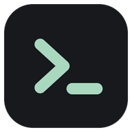
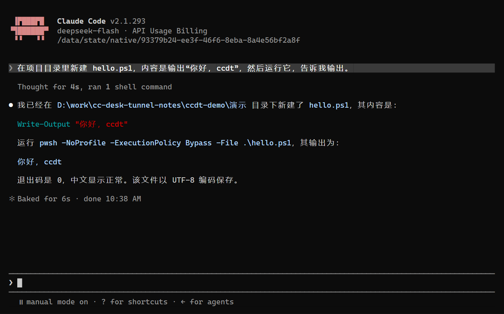

<div align="center">



# CC Desk Tunnel

**一台服务器上的 Claude Code，做你所有电脑共同的大脑**

Claude Code on your own server, working on every computer you own.

[](https://github.com/sun168567/cc-desk-tunnel/releases/latest)
[](https://github.com/sun168567/cc-desk-tunnel/releases)
[](https://github.com/sun168567/cc-desk-tunnel/actions/workflows/check.yml)
[](#2-安装客户端)
[](#1-部署服务端)
[](LICENSE)

**简体中文** · [English](README.en.md)

[📥 下载](https://github.com/sun168567/cc-desk-tunnel/releases/latest) ·
[🚀 快速开始](#快速开始) ·
[🖼️ 界面预览](#界面预览) ·
[🔒 安全须知](#安全须知) ·
[📖 文档](#文档) ·
[🩺 常见问题](docs/troubleshooting.md)

</div>


<p align="center"><sub>左侧：本机项目，以及其他电脑上的项目和会话，在线的可直接操作。右侧：一个会话按名字操作两台内网机器，改动前等你批准。</sub></p>

> [!WARNING]
> **本项目主要由 AI 编写**，个人维护，没有经过专业安全审计。它让一台服务器能在你的电脑上执行命令，使用前请读完[安全须知](#安全须知)和[账号须知](docs/account.md)，自行评估风险。
>
> 本项目与 Anthropic 没有隶属或合作关系；“Claude”“Claude Code”是 Anthropic 的商标。

## 💡 这是什么

Claude Code（简称 CC）运行在你自己的 Linux 服务器上，会话、上下文、记忆和 Claude 账号都集中在那里。你的每台电脑，包括没有公网 IP 的内网机器，主动连出一条加密通道，就成为 Claude 的执行端：项目代码、工具链和文件留在各自的电脑上，Claude 经通道在那里读写文件、运行命令。

- 🧠 **集中在一处**：换一台电脑、打开浏览器或手机，都能接着同一个会话做。
- 🔌 **不需要公网**：电脑主动连出，不开入站端口，不用 VPN 或内网穿透。
- 🤝 **多端共用**：图形客户端、浏览器和手机、终端里的 `ccdt`、Codex 等其他 agent，用的是同一批会话。

### 和常见做法有什么不同

个人用的 agent 通常装在代码所在的电脑上，远程和网页端是这台电脑的延伸；要么在云端沙箱里另外克隆一份代码来跑。CC Desk Tunnel 反过来：**agent 常驻在服务器上，你的电脑是它的手。**

| 常见做法 | 麻烦在哪 | 用 CC Desk Tunnel |
| --- | --- | --- |
| 每台电脑各装一份 Claude Code、各登录一次 | 会话和记忆留在各自的电脑上，换一台就接不上；登录凭据散在每台电脑上 | 会话、记忆和账号都在服务端，哪一端都能接着做；电脑上不存 Claude 的凭据 |
| 把项目搬到服务器或云端沙箱里开发 | 工具链要重装；用不到本机的编辑器、模拟器、桌面软件和内网资源 | 项目和工具链留在原地，命令在原地执行；服务器只跑 Claude Code，低配即可 |
| 经 VPN、内网穿透或远程桌面操作内网机器 | 要有公网入口或先组网，端口和密钥都要管；远程桌面延迟高 | 电脑主动连出；一个会话就能按名字操作你所有在线的电脑 |
| 直接用命令行界面 | 多个项目和会话不好管理，过程挤在一屏滚动的文字里 | 按项目分组的会话列表，过程折叠成摘要；想用原版 CLI 时在 `ccdt` 里照常用 |

### 适合怎么用

- 🔁 **在几台电脑之间接力**：公司台式机上开的会话，回家在笔记本上、路上在手机上接着做。
- 🗄️ **一站式管理一批内网设备**：NAS、家庭实验室、测试机、树莓派各自运行 `ccdt online` 保持在线。一句“看看这几台的磁盘和服务”，Claude 逐台 `ssh device-<名字>` 去查；要改动时先问你，审批卡片写着在哪台机器上执行什么。
- 📱 **离开电脑也能跟进**：长任务在电脑上跑，人在外面用手机看进度、批准、追加指示；被操作的电脑不暴露任何端口。
- 🤖 **和其他 agent 协作**：其他 agent 或脚本用 `ccdt -p` 把任务交给 Claude，审批交回调用方；编辑器用 `ccdt acp` 接入。反过来，Claude 也能调用你电脑上的 Codex 等命令行 agent。

只有一台电脑、在本机跑 Claude Code 已经很顺手时，直接用本地版更简单，延迟也更低。

<a id="界面预览"></a>

## 🖼️ 界面预览

<table>
  <tr>
    <td width="50%"></td>
    <td width="50%"></td>
  </tr>
  <tr>
    <td align="center"><b>📂 文件面板</b><br><sub>本机、服务端和每台在线电脑的文件，一处浏览、预览、互相复制</sub></td>
    <td align="center"><b>📱 浏览器与手机</b><br><sub>可选开启，看进度、批准、追加指示</sub></td>
  </tr>
  <tr>
    <td width="50%"></td>
    <td width="50%"></td>
  </tr>
  <tr>
    <td align="center"><b>⏰ 定时任务</b><br><sub>到点向会话发送预设的提示词，也可以让 Claude 帮你设置</sub></td>
    <td align="center"><b>⌨️ 终端客户端 ccdt</b><br><sub>原版 Claude Code 的终端界面，与图形客户端共用会话</sub></td>
  </tr>
</table>

## ✨ 功能

| | |
| --- | --- |
| 🖥️ **多台电脑** | 每台电脑的项目和会话集中列出，离线的也在；在另一台在线电脑上新建会话、把会话移过去；一个会话按名字连到你其他在线的电脑；`ccdt online` 让没有图形界面的机器保持在线 |
| 🗂️ **项目与会话** | 项目由服务端登记、各端共用，可改名、移除；新建、搜索、分叉、导出 Markdown；从任意一条自己的消息“编辑重发” |
| 💬 **对话过程** | 流式回复、思考摘要、工具调用的入参与结果；运行中追加消息、随时停止；计划显示为文档，可修改后再执行 |
| 🎛️ **原生控制** | 模型、推理强度、审批模式、上下文占用与主动压缩、Claude Code 常用设置；一键在 `ccdt` 里打开当前会话 |
| ⌨️ **终端客户端** | `ccdt` 在自己的终端里打开原版 Claude Code，与图形客户端共用会话、上下文和调用统计；更省 5 小时额度（见[账号须知](docs/account.md)） |
| 🤖 **与其他 agent 协作** | 其他 agent 和脚本经 `ccdt -p` 派发、跟进任务并处理审批，编辑器经 `ccdt acp` 接入；Claude 也能调用电脑上的命令行 agent |
| 📂 **文件面板** | 浏览本机、服务端和其他在线电脑的文件：预览、上传下载、在不同位置之间复制粘贴 |
| 📱 **浏览器与手机** | 可选开启：操作在线电脑上的会话，或新建在服务端执行的普通会话；手机上可安装为应用；不增加端口或容器 |
| 📊 **账号与用量** | 在客户端里登录、退出服务端的 Claude 账号，查看额度、重置时间和调用统计；提示缓存过期前可自动压缩 |
| ⏰ **定时任务** | 到点由客户端向指定会话或新会话发送预设提示词，也可以直接让 Claude 帮你设置 |
| ⬆️ **升级与备份** | 在客户端里点一下即可升级服务端和客户端，不必登录服务器；服务端一条命令备份与还原 |
| 🧩 **省心** | 托盘后台、记住凭据与自动登录、未发送的内容按会话保存 |

## ⚙️ 工作方式

- 服务器和每台电脑之间只有一条 **WSS 加密隧道**，用同一个地址和端口。里面有两类连接：客户端与服务端之间的对话，以及 Claude Code 经 SSH 操作这台电脑的执行通道。
- 电脑**主动连出**，不需要公网 IP 或入站端口。每次连接临时生成 SSH 密钥，断开即销毁，电脑上不装常驻服务。
- 每个会话在它的项目所在的电脑上执行，同时能按名字连到你其他在线的电脑。
- 本项目只是官方 Claude Code 之上的一层胶水：图形客户端经官方 Agent SDK 运行它，`ccdt` 直接运行交互式的原版 CLI。不改 CLI 本体，不替换它的工具、审批和上下文管理。

<details>
<summary>连接示意图（以一台 Windows 电脑为例）</summary>


更多见[架构](docs/architecture.md)。

</details>

本仓库公开客户端、服务端和构建、部署脚本的全部自有源码，不另设闭源功能。**这不意味着 Claude Code 也被本项目开源**：官方 CLI 与 Agent SDK 由官方渠道安装，仍按 Anthropic 的条款使用；随包的第三方组件各自遵循其许可，见 [NOTICE](NOTICE)。

<a id="快速开始"></a>

## 🚀 快速开始

**需要准备：**

- 🐧 **服务器**：一台有公网 IP 或域名的 Linux 服务器，已装 Docker，推荐 Ubuntu；x86_64，arm64 为实验性支持。编译和测试都在你的电脑上跑，**2 核 1 GB 的入门机型就够**。
- 💻 **电脑**：Windows 10 / 11 x64。macOS、Linux 的图形客户端和 `ccdt` 为实验性支持；没有图形界面的 Linux 用 `ccdt`。

### 1. 部署服务端

在服务器上执行：

```sh
sudo bash -c "$(curl -fsSL https://raw.githubusercontent.com/sun168567/cc-desk-tunnel/main/deploy/install.sh)"
```

一路回车即可。装完会打印客户端要填的**服务地址、证书指纹、服务凭据**，以及要在防火墙放行的端口（默认 TCP 8787，只有这一个）。以后在客户端的“设置 → 关于与更新”里就能升级服务端，一般不用再登录服务器。

<details>
<summary>脚本做了什么 · 日常管理命令</summary>

1. 检查 Docker、Docker Compose 等依赖。缺少时只告诉你安装命令，不替你安装系统软件。
2. 从发布页下载最新的服务端程序包并校验，解压到 `/opt/cc-desk-tunnel`。
3. 询问公网地址、证书方式、端口和数据目录（都有默认值），拉取这个版本的镜像并启动。镜像预先构建在 `ghcr.io/sun168567/cc-desk-tunnel`（x86_64 和 arm64 自动选择）；连不上 ghcr.io 时改为在服务器上构建，首次要多等几分钟。
4. 打印客户端要填的三项信息和要放行的端口。脚本不修改防火墙、nginx 或 SSH 配置。

日常管理用 `cc-desk-tunnel` 命令，在任何目录下都能运行：

```sh
sudo cc-desk-tunnel status    # 运行状态
sudo cc-desk-tunnel logs      # 查看日志（Ctrl+C 退出）
sudo cc-desk-tunnel upgrade   # 升级到最新版本；数据、账号和配置保留
sudo cc-desk-tunnel help      # 全部命令：更换凭据、备份恢复、证书等
```

</details>

手动安装、三种证书方式、备份恢复见[部署操作手册](deploy/README.md)；已有 nginx 和域名时见[用 nginx 反代](deploy/nginx.md)。

### 2. 安装客户端

两种客户端可以只装一种，也可以都装；都要与服务端是**同一版本**。

| | 适合 | 获取 |
| --- | --- | --- |
| 🖥️ **图形客户端** | 按项目管理各台电脑上的会话，过程折叠成摘要 | [最新发布页](https://github.com/sun168567/cc-desk-tunnel/releases/latest)开头的表格：Windows `.exe`；macOS `.dmg`、Linux `.deb`（实验性，见 [macOS](docs/macos.md) · [Linux](docs/linux.md)） |
| ⌨️ **终端客户端** | 即 `ccdt`：在自己的终端里用原版 Claude Code；也适合没有图形界面的机器 | Windows 图形客户端已自带；单独安装用下面的命令 |

Windows 安装包自带 PowerShell 7、OpenSSH 和 `ccdt`，不用另装任何东西；启动后填入上一步的三项信息并连接。

<a id="杀毒软件与-smartscreen"></a>

> [!NOTE]
> 安装包没有代码签名。Windows 首次运行出现“Windows 已保护你的电脑”时，点“更多信息 → 仍要运行”；内置组件被安全软件拦截时先核对再放行，见[杀毒软件与 SmartScreen](docs/troubleshooting.md#杀毒软件与-smartscreen)。macOS 与 Linux 的客户端升级时需要重新下载安装。

单独安装 `ccdt`（只为当前用户安装，不需要管理员权限，装好后运行 `ccdt login`）：

```powershell
# Windows（PowerShell）
irm https://raw.githubusercontent.com/sun168567/cc-desk-tunnel/main/deploy/install-ccdt.ps1 | iex
```

```sh
# macOS、Linux（实验性）
curl -fsSL https://raw.githubusercontent.com/sun168567/cc-desk-tunnel/main/deploy/install-ccdt.sh | sh
```

脚本安装最新正式版并按 `SHA256SUMS` 校验；服务端不是最新版时，指定与它相同的版本，见[终端客户端](docs/cli.md#安装)。

### 3. 登录 Claude

在客户端“设置 → 账号与额度”登录你的 Claude 账号，添加一个项目文件夹，开始对话。

- **普通登录**：打开官方授权页，把页面给出的代码粘贴回来，与官方 `claude auth login` 相同。
- **Setup token 登录**：由服务端运行官方命令生成，授权后自动保存；已有令牌也可以直接粘贴。令牌只存在服务端，图形客户端与 `ccdt` 共用。这种方式通常看不到账号资料和完整额度，见[登录方式差异](docs/native-runtime.md#登录方式)。

### 4. 接入更多电脑

- **其他电脑**：装图形客户端或 `ccdt`，登录同一个服务端。它们的项目和会话随即出现在每一端的“其他设备”下，会话也能按名字连到它们。没有图形界面的机器运行 `ccdt online` 保持在线，开机常驻见[保持在线](docs/cli.md#保持在线)。
- **浏览器与手机**：在桌面客户端“设置 → 浏览器访问”中开启，用服务凭据登录显示的地址，建议开启两步验证。浏览器本身不是执行端：它操作在线电脑上的会话，或新建在服务端执行的普通会话。见[浏览器访问](docs/server-web.md)；不用时保持默认关闭。

<a id="安全须知"></a>

## 🔒 安全须知

> [!IMPORTANT]
> **服务器必须是你自己控制、可信的机器。** 连接期间，服务器能以你的用户身份在每台已连接的电脑上执行任意命令。服务器被攻陷，等于这些电脑都被攻陷；接入的电脑越多，影响面越大。

1. 🔑 **服务凭据等同于完全控制权。** 拿到它的人能用你的 Claude 账号，并在你每台已连接的电脑上执行任意命令。用脚本生成的随机凭据，不要改成短口令，不要截图或贴到聊天、issue 里；泄漏后在服务器上运行 `sudo cc-desk-tunnel token` 更换。
2. 🧱 **不是沙箱。** Claude 能访问你的用户在那台电脑上能访问的一切，不只是项目目录，也能连到你其他在线的电脑。项目只靠提示词引导它在项目内工作、到其他电脑上只做你要求的事，审批沿用 Claude Code 自己的机制。
3. 📤 **数据会离开本机。** Claude 读取的文件片段和命令输出经你的服务器发往模型服务；服务器上存着会话记录和 Claude 登录凭据，备份文件同样包含这些秘密。
4. 🔏 **指纹要从可信渠道取得。** 使用自签证书时，证书指纹应来自你自己登录服务器看到的安装汇总，而不是别人转发的消息。

🌐 **端口**：服务器只需放行一个 TCP 端口（默认 8787；用 nginx 时是 443），通往你电脑的 SSH 端口只在容器内部监听，外部无法访问；电脑一侧不需要放行任何入站端口。可以再用云厂商的安全组只允许自己的出口 IP 访问。细节见[部署与安全边界](docs/deployment.md#端口与协议)。

> 请 AI 助手帮你部署时，也让它先读这一节，并提醒你：只放行一个端口、保管好服务凭据、确认服务器可信。

完整的威胁模型、已有防护和漏洞报告方式见 [SECURITY.md](SECURITY.md)。

<a id="账号须知"></a>

## 👤 账号须知

本项目运行的是你服务器上的官方 Claude Code：官方流程登录，不修改 Claude Code，不经手也不改写它与模型服务之间的请求，不伪造地区、设备或客户端身份。这是对结构的说明，**不是对账号安全的保证**：

- 📍 **服务器所在地就是你的使用地点**：全部请求都从服务器发出。请选择位于 [Anthropic 支持的国家和地区](https://www.anthropic.com/supported-countries)、来源正常的服务器；放在不支持的地区或被滥用过的 IP 上，可能触发风控。
- 📜 **条款由你自己确认**：订阅登录和 Agent SDK 的使用范围见 Anthropic 的[法律与合规说明](https://code.claude.com/docs/en/legal-and-compliance)；拿不准时改用 API key。
- ⏱️ **5 小时额度**：据社区实测（[#136](https://github.com/sun168567/cc-desk-tunnel/issues/136)），经 Agent SDK 运行时计入 5 小时额度的比例约为交互式 CLI 的两倍，每周额度不受影响；额度紧张时在 `ccdt` 里做长任务。
- 👤 **单用户自用**：一个服务对应一个使用者，一个账号只给自己用，不共享、不转售。

完整说明见[账号须知](docs/account.md)。

<a id="文档"></a>

## 📖 文档

| 文档 | 内容 |
| --- | --- |
| 🩺 [常见问题与排查](docs/troubleshooting.md) | 连接失败、用着用着断开、杀毒软件与 SmartScreen |
| 📦 [部署操作手册](deploy/README.md) | 安装、升级、三种 TLS 入口、备份恢复、日常运维 |
| 🛡️ [部署与安全边界](docs/deployment.md) · [安全说明](SECURITY.md) | 端口、证书、凭据、信任边界；威胁模型、已知不足、漏洞报告 |
| 👤 [账号须知](docs/account.md) | 在 Anthropic 看来这是什么、使用地点、条款、额度、使用边界 |
| ⌨️ [终端客户端 ccdt](docs/cli.md) | 安装、登录、命令、保持在线、供其他 agent 使用 |
| 🌐 [浏览器访问](docs/server-web.md) | 可选的 Web 工作台、登录、域名与路径、证书和反向代理 |
| 🍎 [macOS 客户端](docs/macos.md) · 🐧 [Linux 客户端](docs/linux.md) | 实验性：安装、与 Windows 的不同、验证情况 |
| 🏗️ [架构](docs/architecture.md) · [原生运行与会话存储](docs/native-runtime.md) | 组成与连接过程；如何驱动官方 CLI、上下文、审批、保留期 |
| 🧭 [路线与现状](docs/roadmap.md) · [变更记录](CHANGELOG.md) | 已完成、待验证、计划；各版本的变化 |

模块说明：[图形客户端](apps/desktop/README.md) · [服务端](apps/server/README.md) · [消息契约](packages/protocol/README.md)。文档目前只有中文。

<a id="从源码构建"></a>

## 🛠️ 从源码构建

需要 Git、Node.js 24 与 npm；Windows 上使用 PowerShell 7。

```powershell
npm ci
npm run dev               # 本地模拟服务 + 浏览器界面，不需要任何账号
npm test                  # 单元测试；另有 typecheck、test:ui、check
npm run package:windows   # 生成 Windows 安装包，准备步骤见 apps/desktop/README.md
npm run package:server    # 生成服务端程序包，传到服务器后运行其中的 deploy/install.sh
```

<details>
<summary>目录结构</summary>

```text
apps/desktop/       图形客户端：界面（React，浏览器访问共用）、Electron 主进程、连接桥与本机执行组件
apps/cli/           终端客户端 ccdt
apps/server/        服务端：会话与项目、Claude Code 适配、设备执行通道、文件、调用统计、版本跟踪
packages/protocol/  两端消息契约（Zod）
deploy/             Docker 部署与运维脚本
scripts/            工程检查、开发启动、打包、发布
docs/               跨模块的架构、部署、开发文档
```

</details>

开发规范见[开发约定](docs/development.md)。

## 🤝 社区

认可 [LINUX DO](https://linux.do/) 社区倡导的真诚、友善、团结与专业，也感谢佬友们关于远程开发和开源工具的讨论。欢迎交流使用体验；反馈问题时请先遮盖账号、服务凭据、服务器地址和项目隐私。安全漏洞请走[私下报告入口](SECURITY.md#报告漏洞)。

## ⭐ Star 趋势

[](https://star-history.com/#sun168567/cc-desk-tunnel&Date)

## 📄 许可

[Apache License 2.0](LICENSE)。随包分发的第三方组件及其许可见 [NOTICE](NOTICE)。
